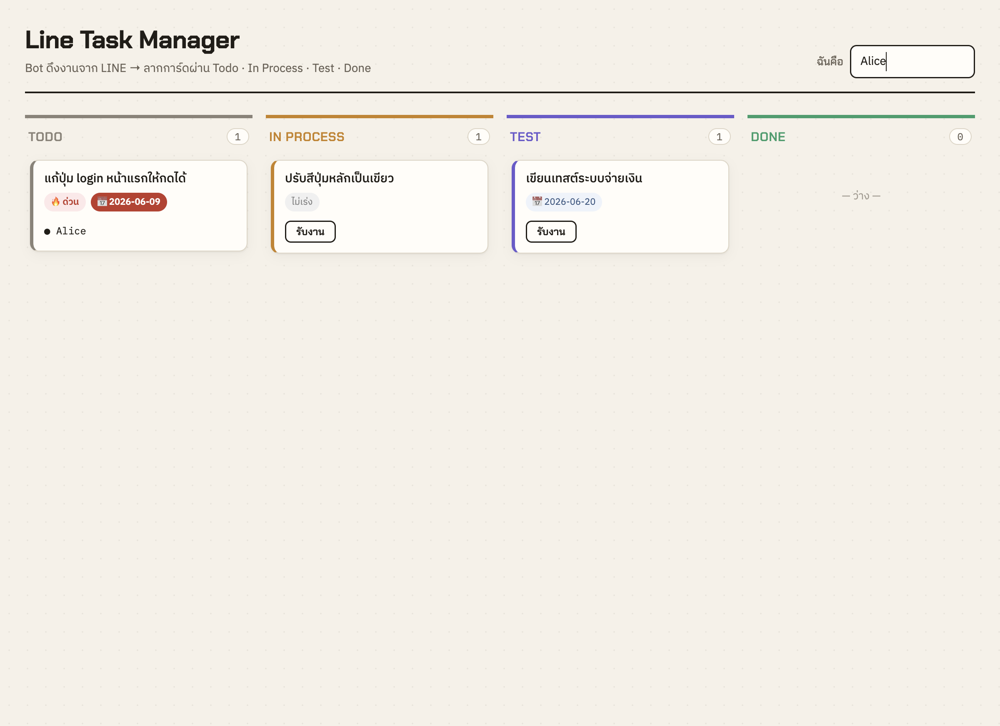

# LINE Task Manager — Kanban board for LINE group chats


LINE Task Manager is a webhook-driven Kanban board that turns LINE group messages into tracked tasks. A bot listens to a LINE group, parses `/task` keyword messages (or, with an Anthropic API key, plain natural-language messages) into cards, and places them on a four-column board — `Todo → In Process → Test → Done`. Status changes and assignments push a notification back to the group. The board is a React SPA served behind nginx; the backend is NestJS with PostgreSQL. Multiple LINE groups can share one deployment with full per-group data isolation via `BOARD_GROUPS`.

**Issues** — [github.com/Tasachii/Line-Task-Manager/issues](https://github.com/Tasachii/Line-Task-Manager/issues)

---

## Screenshots

| Board | Lock screen |
| --- | --- |
|  |  |

---

## What it is

A single deployment handles one or more LINE groups. Each message that contains `/task` (one line = one card) is parsed for priority tokens (`!high`, `!low`, and Thai aliases) and due dates (`@YYYY-MM-DD`). With `ANTHROPIC_API_KEY` set, the Claude API also screens keyword-free messages and promotes those that describe real work. The board reflects every change in real time over WebSocket; group members get a LINE push when a card moves or is assigned.

- **Backend stack** — NestJS 10 · PostgreSQL 16 · @line/bot-sdk 11 · @anthropic-ai/sdk · Socket.IO 4 · TypeScript 5
- **Frontend stack** — React 18 · Vite 5 · @dnd-kit · socket.io-client · TypeScript 5

---

## Repository layout

| Path | Contents |
| --- | --- |
| `backend/` | NestJS app — webhook, REST API, WebSocket gateway, AI extraction, PostgreSQL access |
| `frontend/` | React + Vite Kanban SPA with `nginx.conf` for production |
| `migrations/` | SQL migrations (`line_messages`, `users`, `tasks`) |
| `docs/` | Architecture doc, interactive flow diagrams, roadmap |
| `docker-compose.dev.yml` | Local PostgreSQL published on `:5432` for development |
| `docker-compose.yml` | Production stack via `--profile full`; only nginx is published |
| `.github/workflows/ci.yml` | CI: backend · frontend (required gates) · e2e (best-effort) |

---

## Installation

**Requirements** — [Node 22](https://nodejs.org) · [Docker](https://docs.docker.com/get-docker/) (for PostgreSQL / full-stack deployment)

**Mac / Linux**
```bash
git clone https://github.com/Tasachii/Line-Task-Manager.git
cd Line-Task-Manager
cp backend/.env.example backend/.env    # fill in LINE credentials (see Configuration table)
```

**Windows**
```bat
git clone https://github.com/Tasachii/Line-Task-Manager.git
cd Line-Task-Manager
copy backend\.env.example backend\.env  :: fill in LINE credentials (see Configuration table)
```

---

## Running

### Development

```bash
docker compose -f docker-compose.dev.yml up -d   # start PostgreSQL on :5432

# Backend (separate terminal)
cd backend
npm install
npm run migrate                         # create tables in the local database
npm run start:dev                       # NestJS watch mode on :3000

# Frontend (separate terminal)
cd frontend
npm install
npm run dev                             # Vite dev server on :5173
```

### Production (Docker)

```bash
export POSTGRES_PASSWORD='choose-a-strong-database-password'
docker compose --profile full up -d --build   # PostgreSQL + backend + nginx on :8080
```

The full profile requires `POSTGRES_PASSWORD` and publishes only nginx on `:8080`; PostgreSQL and
the backend remain on the internal Compose network. The backend waits for the database, runs
migrations automatically on startup, and exposes its health check through nginx. Point your domain
or ngrok tunnel at `:8080` — both the Kanban board and the LINE webhook use that single endpoint.

### Upgrading an existing production data volume

PostgreSQL applies `POSTGRES_PASSWORD` only when it creates a new data directory. For an existing
`ltm_pgdata` volume, start only the internal production database, then update the existing `line`
user's password through its local socket. Enter the same value at the prompt that you exported:

```bash
printf 'New database password: '
IFS= read -r -s POSTGRES_PASSWORD
printf '\n'
export POSTGRES_PASSWORD
docker compose --profile full up -d db
docker compose --profile full exec db psql -U line -d line_task_manager -c '\password line'
docker compose --profile full up -d --build
```

The hidden prompt keeps the password out of shell history. Run these commands from the same
checkout and keep the same Compose project name so it reuses the existing named volume.

---

## Connecting a LINE Official Account

1. Create a Provider and a **Messaging API channel** at [developers.line.biz](https://developers.line.biz).
2. **Basic settings** tab → copy **Channel secret** into `backend/.env` as `LINE_CHANNEL_SECRET`.
3. **Messaging API** tab → issue a long-lived Channel access token → `LINE_CHANNEL_ACCESS_TOKEN`.
4. Expose `:8080` publicly: `ngrok http 8080` (dev) or a real domain (prod).
5. Set **Webhook URL** to `https://<your-domain>/webhook`, click **Verify** (must report Success), enable **Use webhook**.
6. In [LINE Official Account Manager](https://manager.line.biz): Response settings → **Chat** off · **Auto-response** off · **Webhooks** on.
7. Account settings → enable **Allow bot to join group chats**.
8. Invite the bot to a group. Send:

```
/task Fix the login button on the landing page !high @2026-07-01
Change the button color to green
```

Two cards appear in Todo (the first with high priority and a due date); the bot confirms intake in the group.

If a `/task` message contains an impossible calendar date such as `@2026-02-30`, the card is still
created without a due date and the confirmation reply explains that the invalid date was omitted.

> Without `ANTHROPIC_API_KEY`, only `/task` messages create cards — plain conversation is ignored.
> With the key set, the AI also classifies keyword-free messages that describe work.
> For deduplication, ignored conversation retains only its LINE message ID and metadata; its text is not stored.

---

## Configuration

All variables are validated at startup by a `class-validator` schema in `backend/src/config/env.validation.ts`. A malformed value fails fast and the backend refuses to boot. In production, `assertProdConfig` additionally requires `BOARD_PASSWORD` **or** `BOARD_GROUPS`, an explicit `CORS_ORIGIN`, and a non-empty `LINE_CHANNEL_SECRET`.

| Variable | Required | Default | Description |
| --- | --- | --- | --- |
| `LINE_CHANNEL_SECRET` | Yes | — | From LINE Developers Console; used to verify HMAC-SHA256 webhook signatures |
| `LINE_CHANNEL_ACCESS_TOKEN` | Yes | — | From LINE Developers Console; used to send push/reply messages |
| `DATABASE_URL` | Yes | — | PostgreSQL connection string |
| `PORT` | No | `3000` | HTTP port the backend listens on |
| `TASK_KEYWORD` | No | `/task` | Prefix that marks a message as a task intake |
| `BOARD_PASSWORD` | Recommended | — | Shared board key for single-group deploys; unset disables auth (dev only) |
| `BOARD_GROUPS` | Multi-group | — | JSON map `{"<group_id>":"<key>"}` — per-group isolation; takes precedence over `BOARD_PASSWORD` |
| `CORS_ORIGIN` | Recommended | `*` | Allowed origin for the board API/WebSocket |
| `NOTIFY_STATUSES` | No | all statuses | Comma-separated statuses that trigger a LINE push (e.g. `done` to conserve quota) |
| `NOTIFY_ASSIGN` | No | `true` | Push to the group when a task is assigned |
| `ANTHROPIC_API_KEY` | No | — | Enables AI classification of keyword-free messages via the Claude API |
| `AI_EXTRACT_MODEL` | No | `claude-haiku-4-5` | Claude model for extraction; use `claude-opus-4-8` for higher accuracy |
| `THROTTLE_LIMIT` | No | `120` | Max board-API requests per IP per window |
| `THROTTLE_TTL_MS` | No | `60000` | Rate-limit window in milliseconds (webhook and `/health` are exempt) |
| `WEBHOOK_CONCURRENCY` | No | `3` | Max LINE events processed concurrently per delivery; bounds AI calls and DB transactions under burst |

### Per-group isolation

`BOARD_GROUPS` maps each LINE group ID to its own board key. A holder of key A sees only group A's tasks — `GET /tasks` is scoped by `WHERE group_id = $1` and the WebSocket gateway joins sockets to a per-group room. Single-group deploys leave `BOARD_GROUPS` unset and use `BOARD_PASSWORD`.

```bash
BOARD_GROUPS={"Cabc123...":"keyA","Cdef456...":"keyB"}
```

---

## API

| Method | Path | Auth | Description |
| --- | --- | --- | --- |
| `POST` | `/webhook` | LINE HMAC signature | Receives events from the LINE platform |
| `GET` | `/health` | None | Health check including database connectivity |
| `GET` | `/tasks` | `x-board-key` | List tasks ordered by column position; scoped to the key's group when `BOARD_GROUPS` is set |
| `PATCH` | `/tasks/:id/status` | `x-board-key` | Change status — card is appended to the target column |
| `PATCH` | `/tasks/:id/move` | `x-board-key` | Move a card to `{status, index}`; used by drag-and-drop |
| `POST` | `/tasks/:id/assign` | `x-board-key` | Assign a task: `{userId, displayName}` |
| `PATCH` | `/tasks/:id` | `x-board-key` | Edit a card: `{title?, description?, assigneeId?, assigneeName?}` |
| `DELETE` | `/tasks/:id` | `x-board-key` | Soft-delete a card (kept in the database, excluded from the board) |

WebSocket: clients send `auth.key` on connect when a password is set; the server emits `task:created`, `task:updated`, `task:deleted`, `tasks:refresh`.

---

## Testing

```bash
# Unit tests — 117 tests across signature verification, webhook controller/service,
# AI extraction (Anthropic SDK mocked), board guard, realtime gateway, DTO validation.
cd backend && npm test

# Unit tests with coverage (c8; thresholds: lines 80, functions 80, branches 70).
cd backend && npm run test:cov

# Integration tests — 6 tests against a real PostgreSQL instance.
# Covers position ordering, advisory-lock concurrency, idempotent saveMessage,
# and findAll group scoping. Requires Postgres up and migrated.
docker compose -f docker-compose.dev.yml up -d
cd backend && npm run migrate && npm run test:integration

# End-to-end tests — Puppeteer/Chrome: board rendering, realtime updates,
# drag-and-drop, and the 400-on-bad-signature gate.
# Requires backend on :3000 (LINE_CHANNEL_SECRET=test_secret) and Vite on :5173.
cd frontend && npm run test:e2e
```

CI runs three jobs on every push and pull request. **backend** (build + unit tests + Postgres integration) and **frontend** (type-check + build) are required gates. **e2e** runs after both pass but is `continue-on-error: true` — browser/Chrome flakiness in the sandboxed runner does not fail the workflow. All jobs use Node 22.

---

## Design decisions

| Topic | Decision |
| --- | --- |
| Webhook signature | Raw-body HMAC-SHA256 (`X-Line-Signature`) verified before any parsing — tampered payloads are rejected with 400 before touching the database |
| Card ordering | A `position` column persists in-column order across moves, inserts, and page refreshes |
| Ordering integrity | Position writes run in a transaction serialized on a per-column PostgreSQL advisory lock — concurrent edits cannot corrupt order |
| Per-group key model | `BOARD_GROUPS` maps each LINE `group_id` to its own board key; `GET /tasks` and the WebSocket room are both scoped to that group, so key A never exposes group B's data |
| Duplicate prevention | `message_id` is claimed atomically to absorb LINE webhook retries — the same message never creates cards twice; ignored chat bodies are not retained |
| AI failure | Extraction errors and timeouts return 503 so LINE retries the webhook; message-ID deduplication prevents successfully handled events from creating duplicate cards |
| Rate limiting | Per-IP throttle on the board API; the LINE webhook and `/health` are exempt |
| Prod startup guard | `assertProdConfig` refuses to boot in production without board auth, explicit `CORS_ORIGIN`, and a non-empty `LINE_CHANNEL_SECRET` |

---

## Roadmap

See [docs/ROADMAP.md](docs/ROADMAP.md) for the full prioritized backlog with code pointers and acceptance criteria.

- [x] Signed webhook (HMAC raw-body)
- [x] Per-group board isolation via `BOARD_GROUPS`
- [x] Advisory-lock ordering with concurrency coverage
- [x] Optional AI extraction with retry-safe webhook intake
- [x] Real-time board updates over WebSocket
- [x] Docker full-stack deployment
- [ ] LINE Login for per-user identity (P0 — before multi-team use)
- [x] Edit and soft-delete cards from the board (P1) — title/description/assignee edit; priority/due-date edit not yet exposed
- [ ] Weekly statistics posted to the LINE group (P1)
- [ ] Structured logging and metrics (P2)

---

## License

MIT © Phasathat Jaruchitsophon
